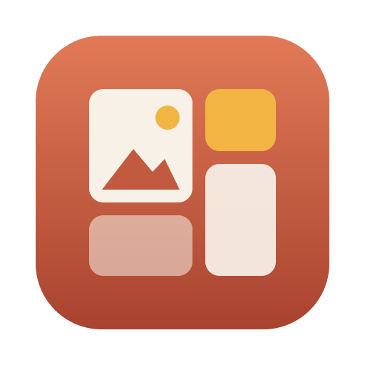

# mosaico



Organize your photos and videos by date, on your own disk. Point mosaico at the folders where
your pictures live — Pictures, a camera's SD card, an external disk — and it finds every photo
and video, works out when each one was taken, shows them on a timeline, and (only after you have
seen and confirmed the plan) copies them into tidy `2023/2023-05 May/` folders. *Mosaico* is
Spanish for *mosaic*.

Native desktop app in Rust with [GPUI](https://www.gpui.rs/) and
[gpui-component](https://github.com/longbridge/gpui-component). All metadata parsing is pure
Rust (no libheif, no exiftool, no ffmpeg). macOS, Windows and Linux. UI in Spanish, English,
Portuguese and French.

## Features

- **Sources:** one or more folders. Hidden folders, app bundles and photo-library packages
  (`*.photoslibrary`, Photo Booth, Lightroom previews…) are never entered; symlinks are not
  followed.
- **Formats:** JPEG, PNG, HEIC/HEIF, GIF, WebP, TIFF, RAW (CR2, CR3, NEF, ARW, DNG, RAF, ORF,
  RW2) and video (MOV, MP4, M4V).
- **Capture date**, best source first, and the app shows which one was used:
  EXIF `DateTimeOriginal` → `CreateDate` → `DateTime`; QuickTime/MP4 creation time (Apple's
  local-time key, then `mvhd`); dates in file names (`IMG_20230514_…`, `PXL_…`, `VID-20230514-WA…`,
  `WhatsApp Image 2023-05-14 at …`, `Screenshot 2023-05-14 at …` and its es/pt/fr forms);
  and finally the file's modified time, flagged as an **uncertain date**.
- **Timeline:** years → months with counts and sizes, and a virtualised thumbnail grid. Filter to
  the items with uncertain dates. Double-click opens a file in the system viewer.
- **Thumbnails** come from the JPEG preview embedded in EXIF / RAW files when there is one
  (instant), otherwise from decoding the image; they are made in parallel and cached as small
  JPEGs in the platform cache folder (`~/Library/Caches/mosaico`, `$XDG_CACHE_HOME/mosaico`,
  `%LOCALAPPDATA%\mosaico\cache`). HEIC files without an embedded preview and videos show a
  placeholder tile.
- **Organize** with a folder template — `{year}/{year}-{month} {month_name}` by default, month
  names in your language — into a destination you choose. **Copy** by default; **move** only if
  you switch to it.
- **Plan preview** before anything happens: every file's destination grouped by folder, with
  counts, sizes, renamed files and skipped ones.
- **Undo:** each organization writes a journal; "Undo" puts everything back.

## Safety

These are your photos, so the rules live in the core library, not in the UI, and are covered by
tests against temporary folders:

- Nothing is copied or moved without the preview and an explicit confirmation.
- **Never overwrites.** A taken name gets ` (2)`, ` (3)`…; a file with the same size and blake3
  hash already at the destination is skipped and reported. Files are written under a temporary
  name and linked into place with an operation that fails if the name exists.
- RAW+JPG pairs, Live Photo videos and `.xmp` / `.aae` sidecars travel with their photo and get
  the same suffix.
- Copies are fsynced and re-read to verify size and hash. A move is a hard link + unlink within
  one filesystem; across filesystems it is copy → fsync → verify → remove the original. Nothing
  else is ever deleted; there is no delete feature.
- Every step is written (and fsynced) to a JSON-lines journal *before* it happens, in mosaico's
  data folder (`~/.otherwise/mosaico/journals`, see *Where files live*), so undo also works after a crash or a cancel. Undo never removes a copy
  whose original is gone, nor a file that changed since it was organized.

## Works with other Otherwise apps

mosaico uses [otherwise-link](https://github.com/otherwisetech/otherwise-link), the small layer
Otherwise Technologies' apps share. Everything stays on your computer.

- **People.** When the shared entity registry is on (in
  [Otherwise Apps](https://github.com/otherwisetech/otherwise-apps) → Entities), select a photo and
  use **Person in this photo** / **Person in this folder** to tag the people your other apps know
  (for example from genealogy-rs). A folder's tag covers everything under it. The sidebar's
  **People** list shows only that person's photos. mosaico only *reads* the registry; the tags live
  in its own data folder (`people.json` next to the journals), never in your photos. They are
  keyed by path, so photos you *move* with Organize lose theirs (copies keep the originals'
  tags). When two people are merged in the registry, their tags follow.
- **Links.** mosaico opens `otherwise-mosaico://` links (also `otherwise://mosaico/…` through
  Otherwise Apps):

  | Link | Does |
  |------|------|
  | `otherwise://mosaico` | brings mosaico to the front |
  | `otherwise://mosaico/open?path=/Volumes/SD/DCIM` | scans that folder (absolute, percent-encoded path) |
  | `otherwise://mosaico/entity/<uuid>` | shows the photos tagged with that registry person |

  macOS registers the scheme from the app's `Info.plist`; Windows registers it for your user
  (`HKCU\Software\Classes\otherwise-mosaico`) when mosaico starts; on Linux `mosaico.desktop`
  declares `x-scheme-handler/otherwise-mosaico` and mosaico makes itself the handler when that
  file is in `~/.local/share/applications`.
- **About** lists the other Otherwise apps installed on this computer; click one to open it.

mosaico has no folder it watches, so it publishes nothing to Otherwise Apps' *Today* view.

## Where files live

- **mosaico's own files** (undo journals, `people.json`, settings, recent folders, the last
  destination) live in the Otherwise data folder, `~/.otherwise/mosaico/` (or wherever you moved
  the data root in Otherwise Apps). Version 0.3 moves them there once from the old folder
  (`~/Library/Application Support/mosaico`, `$XDG_DATA_HOME/mosaico` + `$XDG_CONFIG_HOME/mosaico`,
  `%APPDATA%\mosaico`): each file is renamed, or copied, verified and only then deleted; nothing
  is overwritten, and a journal whose name is already taken moves under a free name so undo keeps
  every run. A `.migrated-to-otherwise` note stays behind. `OTHERWISE_DATA_DIR` points the data
  root elsewhere.
- **Thumbnails** stay in the machine-local cache folder: they can be gigabytes, are rebuilt on
  demand, and shouldn't fill a synced folder.
- **Your photos** go where you choose; the destination you picked last is offered again (never a
  temp folder). The app menu and the globe menu have *Show mosaico's data folder*.
- **Cloud folders:** if a sync client leaves conflicted copies of `people.json`, the People list
  says so, with *Show in Finder*.
- **Help → Crea tu tienda en Vcity** (also in About): a short invitation to
  [Vcity](https://vcity.io), online stores for businesses. The link only carries
  `utm_source=mosaico`; nothing about you.

## Download

Ready-made builds for macOS (Apple silicon and Intel), Linux and Windows are attached to each
[GitHub Release](https://github.com/otherwisetech/mosaico-rs/releases).

- **macOS:** unzip and drag `mosaico.app` to Applications. The app is not notarized yet, so the
  first time right-click it → *Open* (or run `xattr -dr com.apple.quarantine /Applications/mosaico.app`).
- **Linux:** extract the `.tar.gz` and run `./mosaico`; copy `mosaico.desktop` and the icon to
  `~/.local/share/applications` / `~/.local/share/icons` for a menu entry. Needs Vulkan.
- **Windows:** unzip and run `mosaico.exe` (SmartScreen may ask to confirm, since it is unsigned).

The downloads are built by GitHub Actions from the tagged source, but they are **not code-signed
or notarized**. The only network request mosaico makes is reading the project's star count
(`api.github.com/repos/otherwisetech/mosaico-rs`, no login, nothing about you or your photos) at
most once a day, shown next to *Star on GitHub*; turn it off in the globe menu (*Show GitHub star
count*). Photos never leave your machine.

## Build and run

```sh
cargo run -p mosaico-app -- ~/Pictures                  # or no argument for the start screen
cargo run --release -p mosaico-core --example dryrun -- ~/Pictures   # read-only scan + plan, timed
script/bundle-macos.sh                                   # macOS: target/release/mosaico.app
cargo test -p mosaico-i18n -p mosaico-core -p mosaico-app
```

## Layout

```
crates/core  mosaico-core: scan, capture dates (EXIF/TIFF/BMFF parsers), thumbnails, plan,
             apply, journal and undo — no UI
crates/i18n  mosaico-i18n: embedded catalogs (es, en, pt, fr) and i18n guard tests
crates/app   `mosaico` desktop app
```

## License

MIT or Apache-2.0, at your option.

Developed by [Otherwise Technologies LLC](https://otherwisetech.com), Wyoming, USA.
